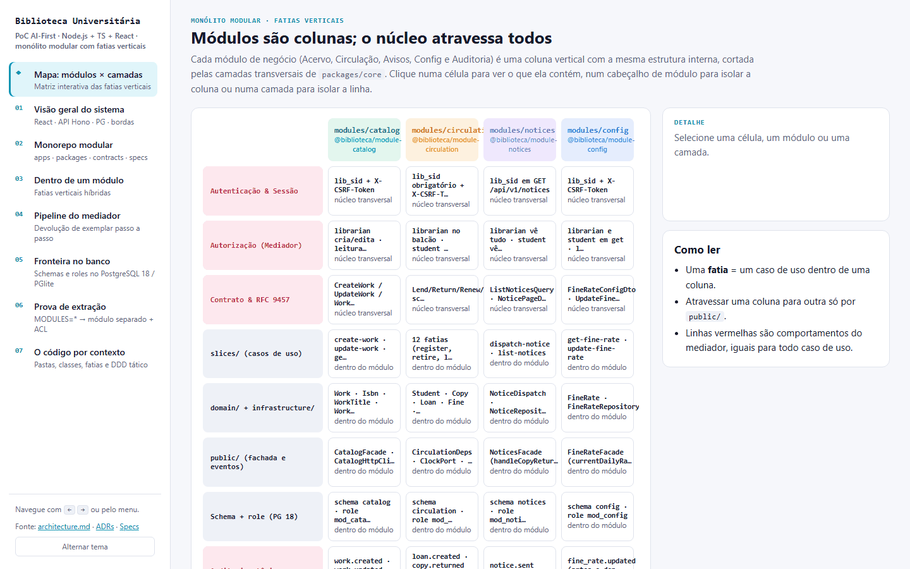
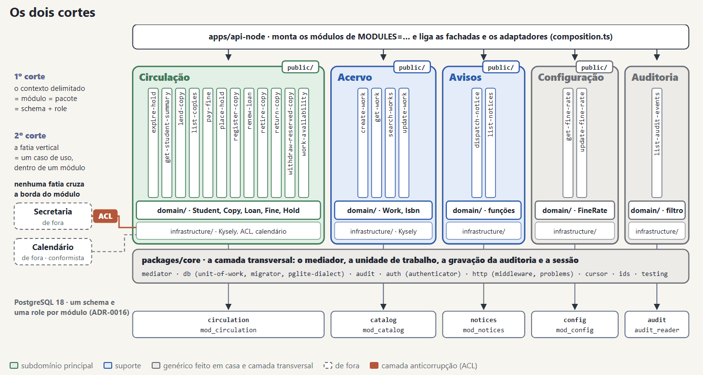

# Biblioteca Universitária: a PoC dos encontros de engenharia de software

O sistema da biblioteca universitária que serve de exemplo nos quatro encontros do treinamento, agora em código que roda.
Ele segue a arquitetura da PoC AI-First da SenseUp: monólito modular, fatias verticais, contrato primeiro e um schema e uma
role por módulo no banco. A stack é uma só: **Node.js 22 + TypeScript** no backend (Hono e Kysely) e **React 19** no
frontend (Vite, Tailwind e TanStack).

> **Experimente sem instalar nada:** abra o projeto num [Codespace](#rode-no-codespaces) ou, quando houver uma
> demonstração no ar, use o endereço dela (`https://...-5173.app.github.dev`).

## O que o sistema faz

| Contexto | Subdomínio | O que faz |
|---|---|---|
| **Circulação** (`circulation`) | principal | Exemplares, empréstimo (até 3 em aberto, nenhum com multa pendente, prazo de 14 dias letivos), devolução com multa por atraso, renovação e reserva com fila (quem reservou primeiro leva e tem 3 dias para retirar) |
| **Acervo** (`catalog`) | suporte | Cadastro e busca de obras |
| **Avisos** (`notices`) | suporte | E-mail para quem reservou, quando o exemplar volta, uma vez só por reserva |
| **Configuração** (`config`) | genérico feito em casa | O valor diário da multa (R$ 1,00 no início), com cada mudança auditada |
| **Auditoria** (`audit`) | genérico feito em casa | A trilha de quem fez o quê, só para consulta |

As regras de negócio (RN-01 a RN-08), o mapa de contexto e a máquina de estados do exemplar estão em
[`docs/dominio.md`](docs/dominio.md).

## Veja a arquitetura

As duas páginas estão publicadas no GitHub Pages: os links abaixo abrem a página. Os arquivos delas ficam em `docs/`.

### [O portal da arquitetura](https://ravarmes.github.io/poc-ai-first-biblioteca/architecture.html)

Os módulos são colunas, e o núcleo (`packages/core`) atravessa todos. A página abre na matriz módulos × camadas (clique
numa célula para ver o que ela contém) e tem sete quadros: visão geral, monorepo, dentro de um módulo, pipeline do
mediador, fronteira no banco, prova de extração e o código por contexto.

[](https://ravarmes.github.io/poc-ai-first-biblioteca/architecture.html)

### [O código por contexto](https://ravarmes.github.io/poc-ai-first-biblioteca/architecture/07-codigo-por-contexto.html)

Os dois cortes do monólito modular no código: cada contexto vira um módulo, e cada caso de uso, uma fatia dentro dele. A
página mostra as pastas e as classes de cada contexto, quem chama quem e o agregado `Student`. Os conceitos de DDD dos
encontros (entidade, objeto de valor, agregado, invariante, regra de dependência) aparecem lado a lado com o código,
marcados `confere`, `parcial` ou `diverge`. Ela é também o quadro 07 do portal.

[](https://ravarmes.github.io/poc-ai-first-biblioteca/architecture/07-codigo-por-contexto.html)

## Rode na sua máquina

Basta o Node.js 22. O banco vem junto: por padrão, a API usa o PostgreSQL em memória do
[PGlite](https://pglite.dev), criado a cada início com dados de demonstração. Tudo o que você fizer some quando a API
para.

```bash
git clone https://github.com/ravarmes/poc-ai-first-biblioteca.git
cd poc-ai-first-biblioteca
npm ci
npm run dev        # a API, em http://127.0.0.1:3001
npm run dev:web    # em outro terminal: o front, em http://localhost:5173
```

Abra <http://localhost:5173>. Para usar um PostgreSQL 18 de verdade, defina `DATABASE_URL=postgres://...`; os schemas, as
roles e as migrations estão descritos em [`contracts/db/README.md`](contracts/db/README.md).

## Rode no Codespaces

[](https://codespaces.new/ravarmes/poc-ai-first-biblioteca)

O Codespace é uma máquina na nuvem com o VS Code no navegador. Este já vem com o Node.js 22 e instala as dependências ao
ser criado, o que leva alguns minutos na primeira vez. O uso sai da cota grátis da sua conta do GitHub: 120 horas-núcleo
por mês no plano Free, e a máquina de 2 núcleos gasta 2 por hora.

- **Para estudar e mexer no código:** `npm run dev` e, em outro terminal, `npm run dev:web`. O Codespaces avisa quando a
  porta 5173 abre, e o front aparece numa aba do navegador.
- **Para mostrar a outras pessoas:** `npm run demo`. O comando compila o front, sobe a API e o front na porta 5173, torna
  essa porta pública e mostra o endereço (`https://<codespace>-5173.app.github.dev`). Quem tiver o endereço abre o
  sistema no navegador, sem conta no GitHub. Os dados ficam em memória, os mesmos para todos, e voltam ao início quando o
  comando para (Ctrl+C).

O endereço só funciona com o Codespace ligado. Ele desliga sozinho depois do tempo sem uso, que é de 30 minutos por padrão
e pode ir até 4 horas em [github.com/settings/codespaces](https://github.com/settings/codespaces) ("Default idle
timeout"). Se a porta não ficar pública sozinha, na aba **PORTS**, clique com o botão direito na 5173 e escolha **Port
Visibility → Public**.

### Contas de demonstração

O login pede só o e-mail, sem senha (é uma demonstração), e a tela de entrada lista as contas.

| E-mail | Quem é |
|---|---|
| `bibliotecaria@bib.edu.br` | Helena, a bibliotecária: balcão, acervo, valor da multa e auditoria |
| `ana@alu.edu.br` | Ana Beatriz Silva, aluna (RA `2026-0001`) |
| `bruno@alu.edu.br` | Bruno Costa Oliveira, aluno (RA `2026-0002`) |

O acervo começa com cinco obras e sete exemplares: `DDD-001`, `DDD-002`, `CA-001`, `CA-002`, `REF-001`, `DDIA-001` e
`ESM-001`.

### Experimente as regras

1. **O limite de 3.** Como bibliotecária, no balcão, empreste três exemplares para a RA `2026-0001` e tente o quarto. A raiz
   `Student` recusa (`loan-limit-reached`, RN-02).
2. **A camada anticorrupção.** Empreste um exemplar para a RA `2026-0003`. A Carla existe na Secretaria, mas com a matrícula
   trancada: a tradução diz que ela não está ativa, e o empréstimo é recusado (RN-06).
3. **A fila de reservas.** Empreste o `REF-001`, o único exemplar de *Refatoração*, para a Ana. Entre como Bruno e reserve a
   obra no catálogo. Volte como bibliotecária e devolva o exemplar: ele fica reservado para o Bruno (RN-07).

## Os sistemas de fora são simulados

A Secretaria acadêmica, o Calendário acadêmico e o serviço de e-mail não existem aqui. Cada um é um adaptador falso
dentro do processo da API, atrás da porta que o domínio declara, como pede o princípio IX da
[constituição](docs/constitution.md).

- **Secretaria**: o `InMemoryAcademicRegistry`, em
  [`academic-translator.ts`](packages/modules/circulation/infrastructure/academic-translator.ts). Ele guarda os registros
  no formato da Secretaria (`ra`, `nome_civil`, `sit_matricula`...) e passa cada um pela camada anticorrupção
  (`translateAcademicStudent`). Tem três alunos: Ana e Bruno, matriculados, e Carla, com a matrícula trancada.
- **Calendário**: o `ConformistCalendarClient`, em
  [`calendar-client.ts`](packages/modules/circulation/infrastructure/calendar-client.ts). Ele recebe `{ dias_letivos }`
  como o Calendário entrega, sem traduzir: é o conformista. Os dias letivos são os de segunda a sexta de 2025 a 2028, menos
  os feriados nacionais de data fixa.
- **E-mail**: o `InMemoryEmailSender` guarda as mensagens numa lista, sem enviar.

## Por onde começar, encontro a encontro

| Encontro | Leia | Veja no código |
|---|---|---|
| 1 · DDD estratégico e requisitos | [`docs/dominio.md`](docs/dominio.md) | os módulos em [`packages/modules/`](packages/modules/) e a camada anticorrupção em [`academic-translator.ts`](packages/modules/circulation/infrastructure/academic-translator.ts) |
| 2 · DDD tático e arquitetura limpa | [o código por contexto](https://ravarmes.github.io/poc-ai-first-biblioteca/architecture/07-codigo-por-contexto.html) | [`circulation/domain/`](packages/modules/circulation/domain/): `Student`, `Copy`, `Loan`, `Fine`, `Hold` e as portas em `ports.ts` |
| 3 · Monólito modular, fatias e SDD | [o portal da arquitetura](https://ravarmes.github.io/poc-ai-first-biblioteca/architecture.html) e [`specs/`](specs/README.md) | as fatias em [`circulation/slices/`](packages/modules/circulation/slices/), as fachadas em `public/` e as regras de fronteira em [`.dependency-cruiser.cjs`](.dependency-cruiser.cjs) |
| 4 · TDD e mutação | os critérios `[n.n]` de cada `specs/*/spec.md` | os `*.test.ts` ao lado do código e o [`stryker.config.mjs`](stryker.config.mjs) |

As decisões estão nas ADRs ([`docs/adr/README.md`](docs/adr/README.md)): 0001 a 0008 são as da biblioteca, e 0009 a 0030,
as da arquitetura desta PoC.

## Como as specs se dividem

Uma spec por capacidade de negócio (`specs/00N-<capacidade>/spec.md`); dentro dela, uma história por caso de uso, com
critérios `[n.n]` no formato Dado / Quando / Então; no código, uma fatia por caso de uso (`slices/<caso-de-uso>/`) e um
teste por critério. Uma spec por micro-operação (`lend-copy`, `return-copy`...) separaria regras que dividem o mesmo
agregado e a mesma máquina de estados; uma spec só para o sistema todo atrasaria a validação. A decisão está na
[ADR-0019](docs/adr/0019-organizacao-das-specs-por-capacidade-e-historias.md) e em [`specs/README.md`](specs/README.md).

| Spec | Capacidade | Casos de uso |
|---|---|---|
| [`001-esqueleto-e-autenticacao`](specs/001-esqueleto-e-autenticacao/spec.md) | Núcleo HTTP, saúde e login | `/health/live`, `/health/ready`, login por e-mail (`librarian`, `student`), `/api/v1/auth/me` |
| [`002-acervo-e-catalogo`](specs/002-acervo-e-catalogo/spec.md) | Acervo | Cadastrar obra, buscar no catálogo em até 1 s com cursor, consultar detalhes, `CatalogFacade` |
| [`003-circulacao-emprestimos-reservas-multas`](specs/003-circulacao-emprestimos-reservas-multas/spec.md) | Circulação | Emprestar, devolver e apurar multa e reserva, reservar, retirar e expirar reserva, renovar, cadastrar exemplar, pagar multa, ver a conta do aluno |
| [`004-avisos-e-eventos`](specs/004-avisos-e-eventos/spec.md) | Avisos | Consumir `CopyReturned` v1, enviar e-mail sem repetir (`idempotencyKey`), consultar avisos |
| [`005-configuracao-multa-e-auditoria`](specs/005-configuracao-multa-e-auditoria/spec.md) | Configuração e Auditoria | Consultar e mudar o valor diário da multa com `version`, consultar a trilha `audit.events` |

## Mapa do repositório

```text
poc-ai-first-biblioteca-main/
├─ AGENTS.md · CLAUDE.md       Regras e glossário para os agentes de IA (e para quem revisa)
├─ .devcontainer/              O ambiente do Codespaces (Node.js 22) e o script da demonstração (demo.sh)
├─ docs/
│  ├─ dominio.md               Modelo estratégico: subdomínios, contextos, linguagem, mapa e regras
│  ├─ constitution.md          Os 10 princípios do projeto
│  ├─ fases.md                 Roteiro de fases, da fundação à prova de extração
│  ├─ architecture.md          A arquitetura em texto, com diagramas Mermaid
│  ├─ architecture.html        Portal visual: matriz módulos × camadas e 7 quadros
│  ├─ architecture/            Os quadros 01 a 07 (o 07 é o código por contexto) e as specs JSON dos diagramas 01 a 06
│  ├─ img/                     As imagens deste README
│  └─ adr/                     30 ADRs (0001–0008 da biblioteca; 0009–0030 da PoC Node e React)
├─ contracts/
│  ├─ openapi/                 Contrato OpenAPI 3.1.1, a fonte da verdade da API
│  ├─ internal/                Contrato interno entre módulos, quando extraídos para HTTP
│  └─ db/                      Migrations PostgreSQL 18 (schemas e roles por módulo) e a spec do runner
├─ specs/                      Specs 001 a 005, cada uma com spec.md, plan.md e tasks.md
├─ packages/
│  ├─ contract/                Esquemas Zod e tipos do contrato
│  ├─ core/                    Camada transversal: mediador, RFC 9457, banco e unidade de trabalho, migrator, cursor, auditoria
│  └─ modules/
│     ├─ catalog/              Acervo
│     ├─ circulation/          Circulação, com a camada anticorrupção da Secretaria e o conformista do Calendário
│     ├─ notices/              Avisos
│     ├─ config/               Valor da multa
│     └─ audit/                Consulta da auditoria
├─ apps/
│  ├─ api-node/                API HTTP: Hono, composição dos módulos (MODULES=* ou só alguns)
│  └─ web-react/               Front: React 19, Vite, Tailwind, TanStack e i18next em pt-BR
└─ tools/
   └─ docs-check/              Verificador de links e diagramas Mermaid dos .md
```

## Comandos

| Comando | O que faz |
|---|---|
| `npm run dev` | Sobe a API (porta 3001) |
| `npm run dev:web` | Sobe o front (porta 5173), que repassa `/api` para a API |
| `npm run demo` | Compila o front e sobe tudo na porta 5173; no Codespaces, torna a porta pública e mostra o endereço |
| `npm test` | Roda a suíte toda: domínio, fatias, SQL e migrations no PGlite, rotas HTTP e componentes React |
| `npm run typecheck` | Confere os tipos do TypeScript no monorepo inteiro |
| `npm run deps:check` | Confere as fronteiras entre módulos, o núcleo e as camadas (`dependency-cruiser`) |
| `npm run mutation` | Teste de mutação com o Stryker (meta: nota de 80% ou mais) |
| `npm run contract:lint` | Valida `contracts/openapi/openapi.yaml` com o Redocly |
| `npm run docs:check` | Valida os links relativos dos `.md` e os blocos Mermaid |
| `npm run build` | Confere os tipos e gera o build da API e do front |
