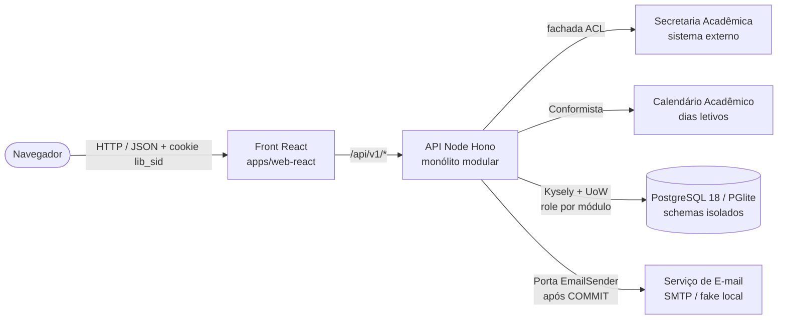
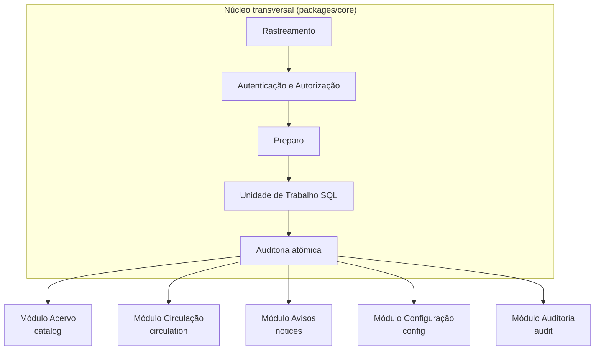
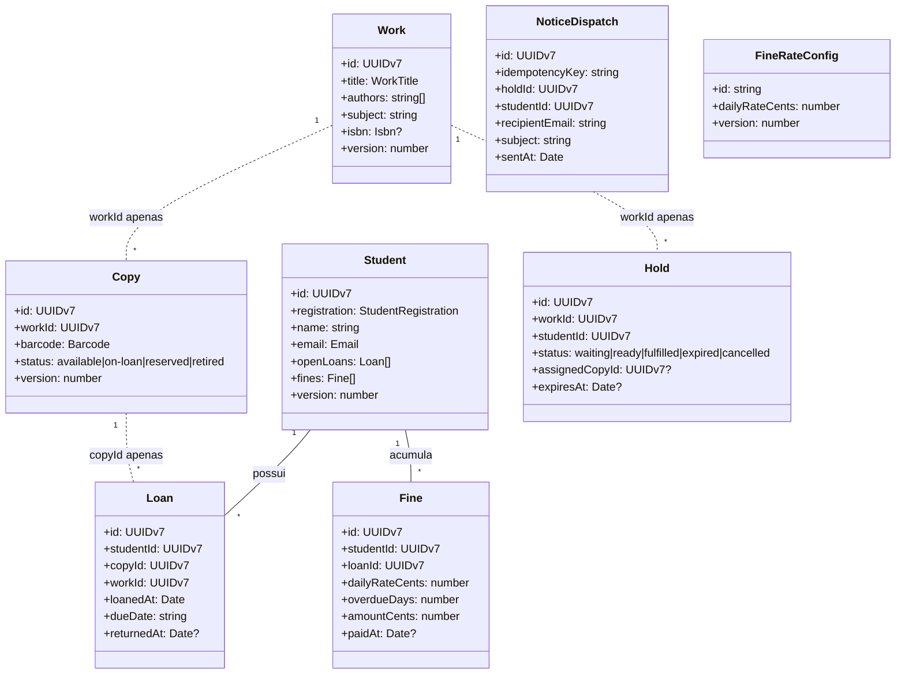
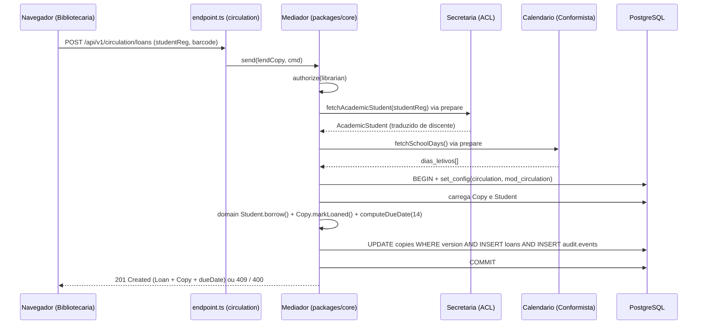
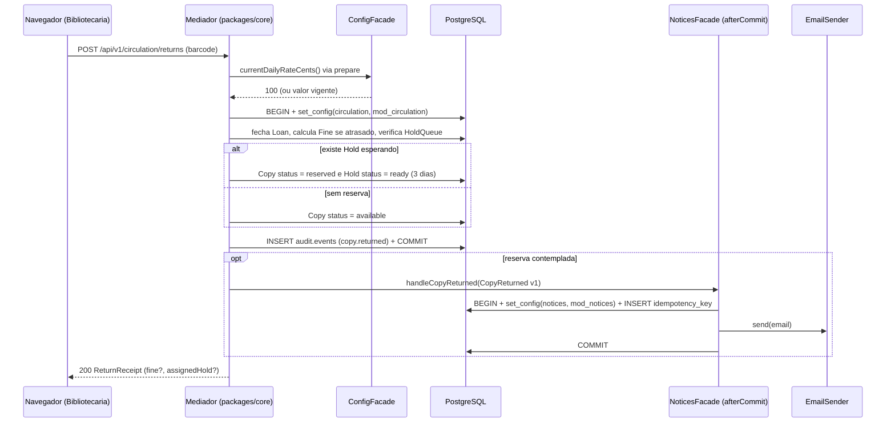

# Arquitetura — PoC AI-First Biblioteca Universitária

> Visão de conjunto das decisões registradas em [`docs/adr/`](adr/README.md). Cada seção conecta o modelo de domínio da biblioteca às decisões técnicas de monólito modular, fatias verticais, fronteiras no PostgreSQL, contratos e testes.

---

## 1. Propósito e escopo

Esta PoC aplica integralmente a arquitetura e o fluxo SDD/TDD de `poc-ai-first-senseup-main/docs/architecture.md` ao domínio da **biblioteca universitária** sobre uma única stack: **Node.js 22+ + TypeScript (Hono + Kysely)** no backend e **React 19 (Vite + Tailwind + TanStack)** no frontend ([ADR-0026](adr/0026-stack-nodejs-typescript-hono-e-ferramental.md), [ADR-0027](adr/0027-frontend-react-tanstack-shadcn-e-msw.md)).

---

## 2. Visão geral do sistema



- A API sobe como monólito único por padrão (`MODULES=*`) e permite ativar apenas um subconjunto de módulos (`MODULES=catalog` vs `MODULES=circulation,notices,config,audit`) com comunicação entre módulos trocada de **em processo** para **HTTP interno** (`/internal/v1/...`) via `CATALOG_ADAPTER=http` ([ADR-0009](adr/0009-monolito-modular-com-extracao-provada.md)).
- Integrações externas ficam atrás de portas explícitas: `AcademicRegistryPort` (**ACL** da Secretaria) e `SchoolCalendarPort` (**Conformista** do Calendário) ([ADR-0023](adr/0023-integracoes-externas-acl-secretaria-e-conformista-calendario.md)).

---

## 3. Núcleo transversal e módulos



Dentro de cada módulo, **fatias verticais híbridas** ([ADR-0015](adr/0015-estrutura-do-modulo-fatias-verticais-hibridas.md)):

```text
packages/modules/<modulo>/
├─ public/           única porta para outros módulos (fachada, cliente HTTP, rotas internas, DTOs)
├─ domain/           VOs, agregados, invariantes, máquina de estados, serviços puros, portas, eventos
├─ infrastructure/   repositórios Kysely/SQL, InMemory* fakes, ACL e adaptadores externos
├─ slices/<caso>/    endpoint.ts · command.ts|query.ts · handler.ts · read.sql.ts · *.test.ts
├─ module.ts         registro das rotas HTTP do módulo
└─ package.json      "exports" expondo apenas ./public e ./module
```

- O núcleo não conhece nenhum módulo (`nucleo-nao-conhece-modulos`).
- Um módulo nunca importa `domain/`, `infrastructure/` ou `slices/` de outro módulo — apenas `public/` (`modulo-so-pelo-public`), garantido pelo `dependency-cruiser` e por `"exports"`.

---

## 4. Modelo de domínio (Circulação, Acervo, Avisos, Config)



> Nota conceitual (Encontro 1, slide 20): em `Aquisições`, "livro" seria `PurchaseItem` (fornecedor, preço, quantidade), mantido fora do código da PoC como contexto distinto de `Work` (`catalog`) e `Copy` (`circulation`).

---

## 5. Dados e fronteiras no PostgreSQL

| Schema | Role com privilégios | Tabelas principais | Regra de isolamento |
|---|---|---|---|
| `catalog` | `mod_catalog` | `works` | Busca no próprio banco (≤ 1 s) |
| `circulation` | `mod_circulation` | `students`, `copies`, `loans`, `fines`, `holds` | Referencia `work_id` apenas por UUID, sem FK entre schemas |
| `notices` | `mod_notices` | `dispatches` | `idempotency_key` `UNIQUE` garante aviso único |
| `config` | `mod_config` | `fine_rates` | Padrão 100 centavos (R$ 1,00/dia); versão otimista |
| `audit` | INSERT para todos os módulos; SELECT apenas `audit_reader` | `events` | Somente acréscimo (append-only); sem `UPDATE`/`DELETE` |

Toda unidade de trabalho executa na abertura da transação:

```sql
SELECT set_config('search_path', $1, true), set_config('role', $2, true);
```

A role de login da aplicação (`app`) é `LOGIN NOINHERIT`: sem `set_config('role', ...)` dentro da transação, qualquer query em tabela de módulo falha com `permission denied`.

---

## 6. Fluxos principais de execução

### 6.1 Emprestar exemplar (`lendCopy` — pipeline do mediador + ACL + Conformista)



### 6.2 Devolver exemplar (`returnCopy` — multa na mesma transação + aviso idempotente pós-commit)



---

## 7. Frontend React

- **Rotas principais**:
  - Tela de entrada (exibida automaticamente pelo shell quando não há sessão) — entrada institucional simplificada (login por e-mail ou seleção rápida de perfil em dev: Bibliotecária ou Aluno matriculado/inadimplente/trancado).
  - `/` e `/catalogo` — busca no acervo (título, autor, assunto, ISBN), paginação por cursor ("Carregar mais"), disponibilidade de exemplares e reserva (`placeHold`).
  - `/meus-emprestimos` — visão do aluno: empréstimos em aberto, contagem (ex.: `2 de 3`), prazos, renovação, multas pendentes, reservas na fila e avisos recebidos.
  - `/balcao` — área da bibliotecária: painéis para **Emprestar**, **Devolver**, **Retirar Reserva / Expirar Reserva**, **Quitar Multa**, **Situação do Aluno** e **Acervo & Exemplares** (cadastrar/editar obra + registrar/baixar exemplar com código de barras).
  - `/configuracoes-auditoria` — área da bibliotecária: **Tabela de Multa (ADR-0007)** (com tratamento de `409 version-conflict`) e **Trilha de Auditoria (`audit.events`)**.

---

## 8. Pirâmide de testes e portões automáticos

| Camada | Ferramenta | Escopo | Portão |
|---|---|---|---|
| Contratos e Docs | Redocly CLI + `docs-check` | OpenAPI 3.1.1 + links Markdown + Mermaid | Obrigatório |
| Fronteiras e Tipos | `tsc --noEmit` + `dependency-cruiser` | Tipagem estrita + módulo-a-módulo apenas via `public/` | Obrigatório |
| Domínio puro | Vitest | VOs, agregados, invariantes, valores-limite, máquina de estados | Obrigatório |
| Fatias e HTTP | Vitest | Handlers com fakes em memória, mediador, RFC 9457, `version-conflict` | Obrigatório |
| SQL & Fronteira DB | Vitest + PGlite / PostgreSQL 18 | Migrations, checksum, lock, `SET ROLE` bloqueando acesso cruzado | Obrigatório |
| Mutação | Stryker (`vitest-runner`) | Domínio e fatias de todos os módulos | **≥ 80%** |
| Frontend React | Vitest + Testing Library + jsdom + MSW | Catálogo, balcão, devolução, multa, conflito de versão (`data-testid`) | Obrigatório |
