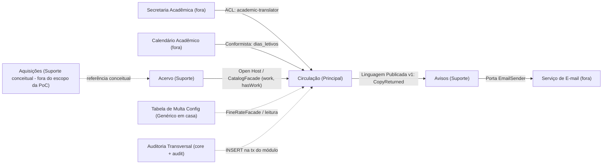
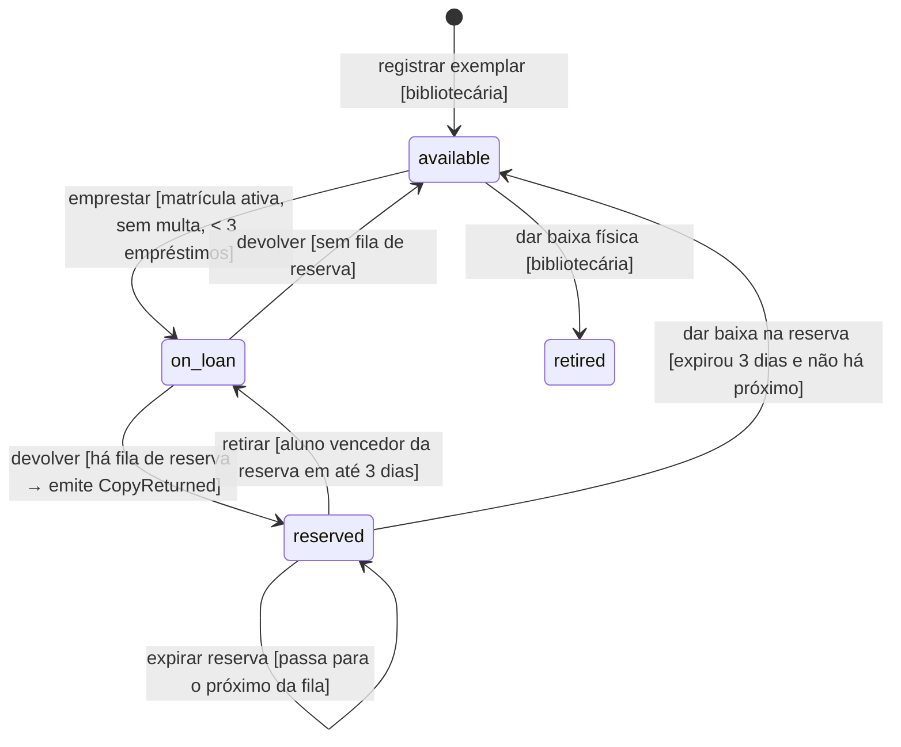

# O Domínio da Biblioteca Universitária — Modelo Estratégico e Requisitos

Consolidação completa do modelo estratégico definido no **Encontro 1** e refinado nos **Encontros 2, 3 e 4** do treinamento, servindo como base única para os contratos, especificações (`specs/`) e implementação deste projeto.

---

## 1. PRD — Requisitos Funcionais e Não Funcionais

### Requisitos Funcionais (Encontro 1, slide 7)

| ID | Descrição | Fatias / Casos de uso associados |
|---|---|---|
| **RF-01** | A bibliotecária registra o empréstimo, a devolução, a renovação e a baixa/retirada de exemplares no balcão. | `lendCopy`, `returnCopy`, `renewLoan`, `withdrawReservedCopy`, `expireHold`, `registerCopy` |
| **RF-02** | O aluno vê os exemplares que tem emprestados, prazos de devolução, reservas na fila e multas pendentes (podendo quitá-las no balcão). | `getMyCirculationSummary`, `getStudentSummary`, `payFine` |
| **RF-03** | O aluno reserva uma obra cujo exemplar está emprestado e recebe a prioridade FIFO quando o exemplar retornar. | `placeHold`, `listMyHolds`, `withdrawReservedCopy` |
| **RF-04** | O sistema avisa o aluno por e-mail quando o exemplar reservado volta ao balcão (com entrega garantidamente idempotente). | Evento `CopyReturned`, `dispatchNotice`, `listMyNotices` |
| **RF-05** | A bibliotecária cataloga obras e ajusta o valor diário da multa em tabela própria com histórico auditado (ADR-0007). | `createWork`, `searchCatalog`, `updateFineRate`, `listAuditEvents` |

### Requisitos Não Funcionais

- **RNF-01 (Desempenho na busca)**: busca por título, autor, assunto ou ISBN no próprio banco do acervo (ADR-0005) responde em **≤ 1 segundo**.
- **RNF-02 (Fronteiras verificáveis)**: fronteiras entre módulos checadas estaticamente (`dependency-cruiser`) e no PostgreSQL (schema + role dedicada por módulo, sem FK cruzada entre schemas).
- **RNF-03 (Qualidade e mutação)**: nota de mutação **≥ 80%** no domínio e nas fatias de aplicação; 100% dos critérios `[n.n]` cobertos por testes automatizados.
- **RNF-04 (Auditabilidade)**: alterações de tabela de multa, mutações de circulação/acervo/avisos e tentativas negadas de autorização gravadas de forma append-only em `audit.events`.

---

## 2. Regras de Negócio (RN-01 a RN-08)

| Regra | Enunciado | Onde mora na arquitetura |
|---|---|---|
| **RN-01** | Aluno com multa pendente não pode retirar novo exemplar nem renovar empréstimo; a recusa informa o valor devido em reais. | Invariante do agregado `Student` (`Student.borrow()` nas fatias `lend-copy` e `withdraw-reserved-copy`; `Student.ensureCanRenew()` em `renew-loan`), conferida pelas multas pendentes que a raiz guarda |
| **RN-02** | Cada aluno pode manter no máximo **3 exemplares emprestados em aberto** simultaneamente. | Invariante do agregado `Student` (`STUDENT_LOAN_LIMIT = 3`): `Student.borrow()` conta os empréstimos em aberto que a raiz guarda, e o repositório grava o Student inteiro com a versão lida (`saveStudent`), o único caminho para criar empréstimo |
| **RN-03** | Todo empréstimo referencia um aluno e um exemplar físico distintos pelo identificador (`studentId`, `copyId`). Referência do exemplar para a obra usa apenas `workId`. | Agregados `Student`, `Loan` e `Copy` sem acoplamento de tabela com `catalog` |
| **RN-04** | A multa diária por atraso é lida de tabela de configuração (padrão **R$ 1,00 / dia**, 100 centavos); toda alteração na tabela é auditada (quem, quando, antes e depois). | Módulo `config` (`FineRateConfig`) + auditoria do mediador (ADR-0007) |
| **RN-05** | O prazo padrão de empréstimo (e renovação) é de **14 dias letivos**, calculado considerando o calendário acadêmico oficial. | Serviço de domínio puro `computeDueDate` + adaptador Conformista `Calendário` |
| **RN-06** | Apenas aluno com **matrícula ativa** na Secretaria acadêmica pode tomar empréstimo ou registrar reserva. | Porta `AcademicRegistryPort` + ACL `academic-translator.ts` na borda da Circulação |
| **RN-07** | Máquina de estados do `Copy`: `available`, `on-loan`, `reserved`, `retired`. Na devolução de exemplar de obra com reserva ativa em fila, o estado passa para `reserved` (nunca `available`) e inicia a janela de **3 dias** para retirada pelo primeiro aluno da fila. | Máquina de estados dentro do agregado `Copy` + coordenação transacional na fatia `returnCopy` |
| **RN-08** | A devolução do exemplar, o cálculo e gravação de eventual multa e a atualização do status/reserva ficam na **mesma transação** da Circulação. O envio do aviso em `Avisos` ocorre em **outra transação** após o commit, protegido por **chave de idempotência** (`idempotencyKey`). | Unidade de trabalho do handler `returnCopy` + callback pós-commit / evento `CopyReturned` v1 + módulo `notices` |

---

## 3. Espaço do Problema — Subdomínios

| Subdomínio | Responsabilidade | Classificação | Justificativa estratégica |
|---|---|---|---|
| **Circulação (`circulation`)** | Emprestar, devolver, renovar, reservar, retirar reserva, calcular e quitar multas, validar regras do balcão | **Principal (Core)** | Reúne o diferencial e as regras próprias da biblioteca (RN-01 a RN-08) |
| **Acervo (`catalog`)** | Catalogar obras (`Work`), indexar e buscar no catálogo | **De Suporte** | Necessário para a Circulação, porém é cadastro/consulta sem regras concorrentes complexas |
| **Avisos (`notices`)** | Receber notificações de retorno de reserva e enviar e-mail sem duplicidade | **De Suporte** | Apoia RF-04 e encapsula idempotência sobre serviço externo de envio |
| **Aquisições (`acquisitions`)** | Pedido de compra de novos títulos (`PurchaseItem`) | **De Suporte (fora da implementação)** | Mapeado conceitualmente no Encontro 1 (`PurchaseItem` separado de `Work` e `Copy`), deixado fora da implementação desta PoC como no recorte do treinamento |
| **Configuração (`config`) & Auditoria (`audit`)** | Parâmetro da tabela de multa e trilha imutável de auditoria | **Genérico feito em casa** | Transversal simples: `audit` aproveita o mediador transversal e `audit.events` |
| **Autenticação / E-mail SMTP** | Identidade universitária (ADR-0002) e transporte de e-mail | **Genérico de fora** | Envolvido atrás de portas/adaptadores (`Authenticator`, `EmailSender`) |

---

## 4. Espaço da Solução — Contextos Delimitados e Linguagem Ubíqua

A mesma palavra do cotidiano do balcão muda de sentido conforme o contexto (Encontro 1, slides 20 e 24):

- Em **Aquisições** (conceitual): "livro" é o item de compra com fornecedor, preço, ISBN e quantidade (`PurchaseItem`).
- No **Acervo (`catalog`)**: "livro" é a **obra** catalogada com título, autores, assunto e ISBN (`Work`). A palavra "exemplar" não pertence às tabelas do Acervo.
- Na **Circulação (`circulation`)**: "livro" vira o **exemplar físico** com código de barras e ciclo de vida (`Copy { id, workId, barcode, status, version }`), emprestado dentro da conta do **aluno** (`Student`). A Circulação consulta o título da obra apenas sob demanda via `CatalogFacade.work(workId)` sem duplicar tabelas do Acervo.
- Na **Secretaria (sistema externo)**: aluno é o registro bruto `discente` (`ra`, `nome_civil`, `sit_matricula`, `cod_curso`), traduzido pela camada anticorrupção para `AcademicStudent { registration, name, active, courseCode }`.

---

## 5. Mapa de Contexto

Relacionamentos entre contextos:

1. **Acervo → Circulação**: **Fornecedor / Cliente via Fachada (`CatalogFacade`)**. A Circulação conhece apenas a interface pública e os DTOs de `packages/modules/catalog/public/`.
2. **Secretaria → Circulação**: **Camada Anticorrupção (ACL)**. Mudanças no payload da Secretaria (`sit_matricula: "MATRICULADO" | "TRANCADO"`) não invadem o agregado `Student`.
3. **Calendário → Circulação**: **Conformista**. O domínio consome diretamente o vetor de datas letivas no formato do Calendário em `computeDueDate`.
4. **Circulação → Avisos**: **Linguagem Publicada v1**. O evento `CopyReturned` carrega apenas os identificadores e instantes contratuais estáveis (`copyId`, `workId`, `returnedAt`, `holdId`, `studentId`, `studentEmail`, `workTitle`), e `Avisos` deduplica por `idempotencyKey`.

---

## 6. Máquina de Estados do Exemplar (`Copy`)

Conforme Encontro 1, slide 26:

> Nota: no código (ADR-0030), os estados do tipo `CopyStatus` são `"available" | "on-loan" | "reserved" | "retired"`. Tentativas inválidas (ex.: emprestar um exemplar já `"on-loan"`, emprestar um `"reserved"` para outro aluno, devolver um `"available"`) lançam erros de domínio específicos mapeados para `409 Conflict` em RFC 9457.
